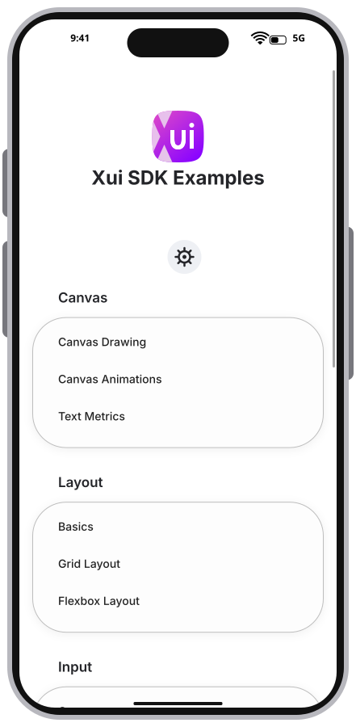
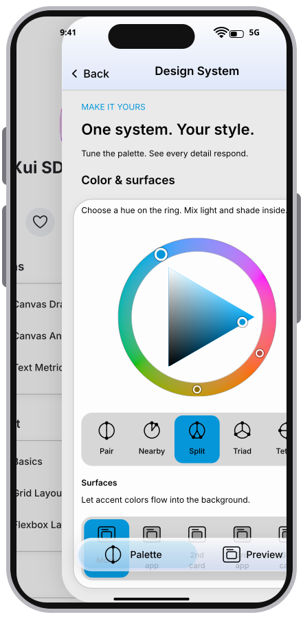
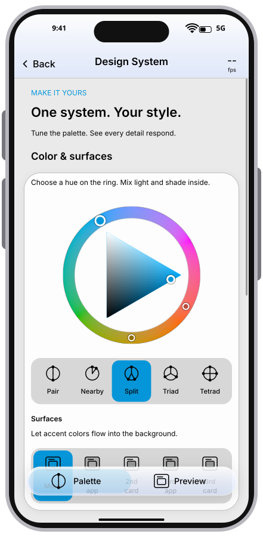
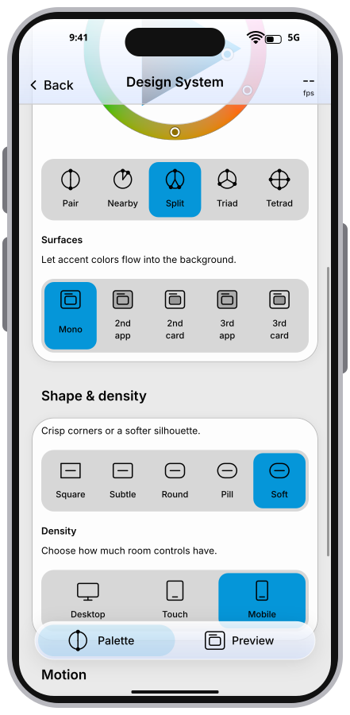

# Integration Test Run

## Timeline

# Retained page composition

Pages, cards, and scrolling viewports are separate keyed surfaces. Card borders and shadows follow rounded outlines, and culled cards can reuse their retained drawings. The toolbar uses native Liquid Glass with a translucent selection. Headers blur the content scrolling beneath them, including the top safe area. SVG approximates the materials while keeping labels crisp.

### 01. Home

### 02. PageTransition

### 03. GlassToolbar

### 04. BlurredHeader

