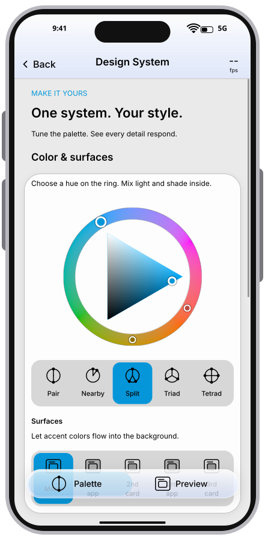

# Design system

A suite within the Integration test project for palette math, retained theme updates, widget invalidation,
mobile input, animation, and SVG specifications. Run from the repository root:

```sh
dotnet test Xui/Tests/Integration/Xui.Tests.Integration.csproj --filter FullyQualifiedName~Xui.Tests.Integration.DesignSystem
```

The suite checks zero allocations during hue and shade pointer updates, stable
palette identities, render-only color/shape changes, and layout invalidation for
typography/density. It also checks sRGB gamut boundaries, readable action text,
separated surface tones, concentric segmented corners, and continuous tab swipes.
Tests use the deterministic runtime, embedded Inter fonts, and embedded images.

## Visual specifications

- [Color shades and all five corner presets](Scenarios.Emulator.iPhone15Pro/ColorAndRoundnessGallery/README.md)
- [iPhone editor, transitions, and live controls](Scenarios.Emulator.iPhone15Pro/DesignSystemLiveUpdates/README.md)
- [Android editor, transitions, and live controls](Scenarios.Emulator.pixel8Pro/DesignSystemLiveUpdates/README.md)



The picker retains its hue-ring bitmap. Its triangle composites a solid hue with
a reusable white/black alpha mask; moving the hue does not generate or upload a
new image. The mask is generated and checked by
[`ColorTriangleSnapshotTest`](../../Component/GPU/ColorTriangleSnapshotTest.cs),
using Xui's software GPU vertex/fragment pipeline like the color-wheel generator:

```sh
dotnet test Xui/Tests/Component/Xui.Tests.Component.csproj --filter FullyQualifiedName~ColorTriangleSnapshotTest
```

If the shader changes or the app asset is missing, the test writes
`Xui/Tests/Component/GPU/Snapshots/ColorTriangle.Actual.png`. Review that output,
then copy it to `Xui/Apps/TestApp/Assets/ColorTriangle.png` and rerun the test.
Passing tests remove the temporary output; they never overwrite the app asset.

Review SVG diffs and rendered previews before promoting changed baselines. Each
scenario README has one image per state so the committed output reads as a spec.
