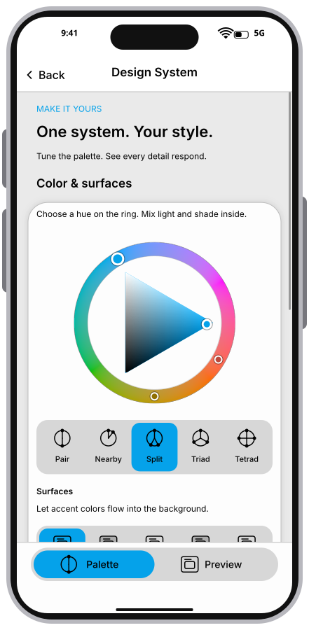
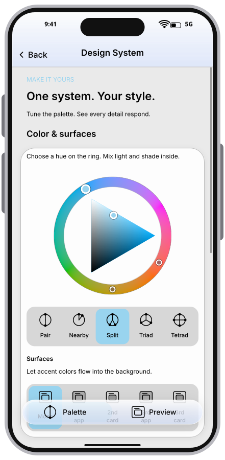
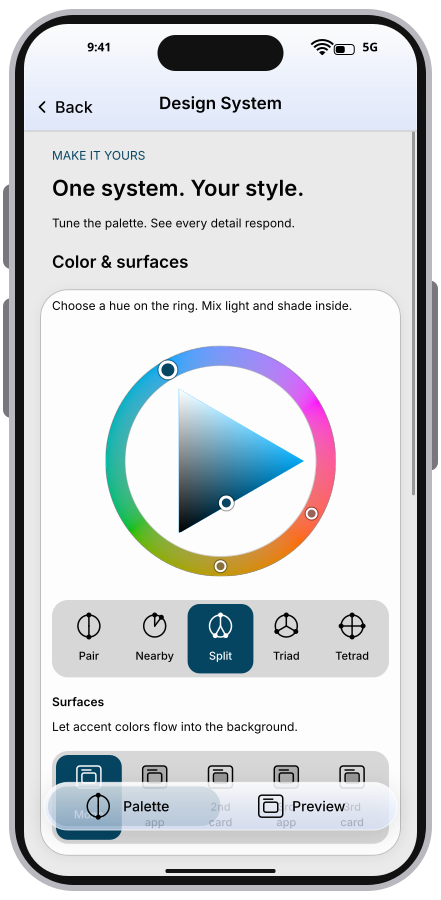
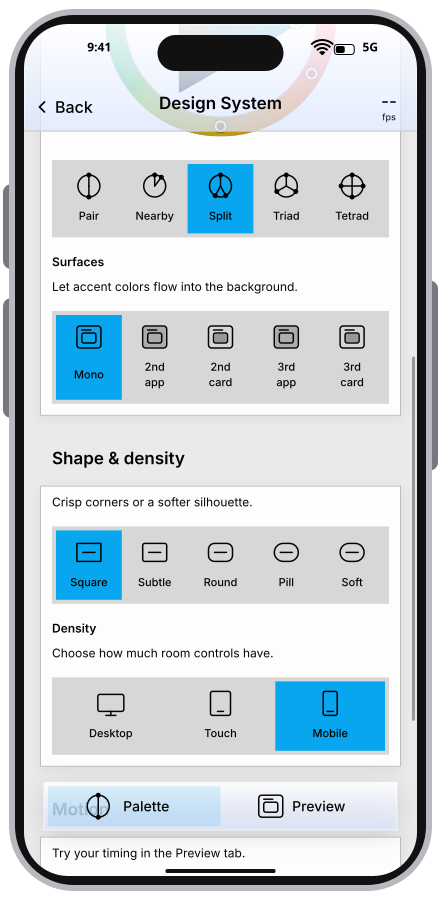
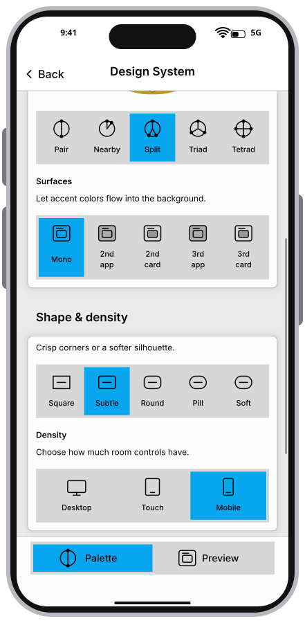
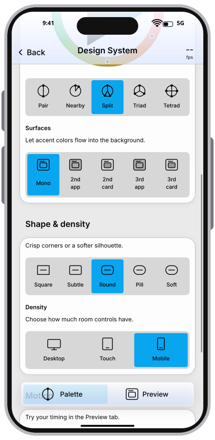
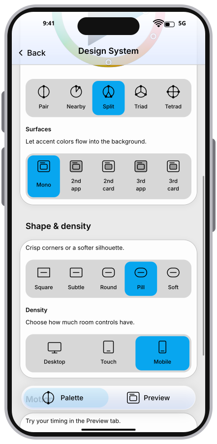
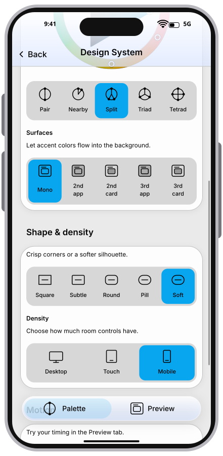

# Integration Test Run

## Timeline

# Color and roundness

The hue ring preserves the selected shade; the inner triangle mixes white (upper left), black (lower left), and hue (right). Rounded tracks and their inset highlights share corner centers.

### 01. Vivid

### 02. Light

### 03. Dark

### 04. Square

### 05. Subtle

### 06. Round

### 07. Pill

### 08. Soft

