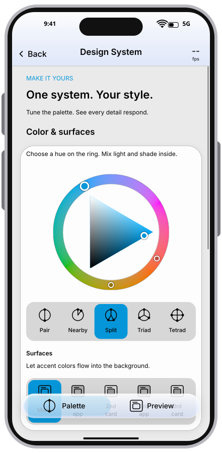
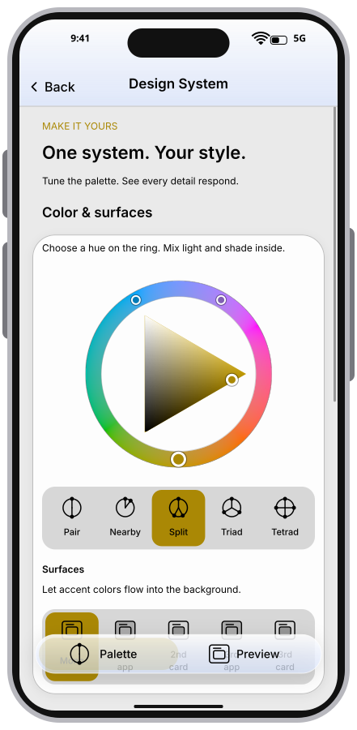
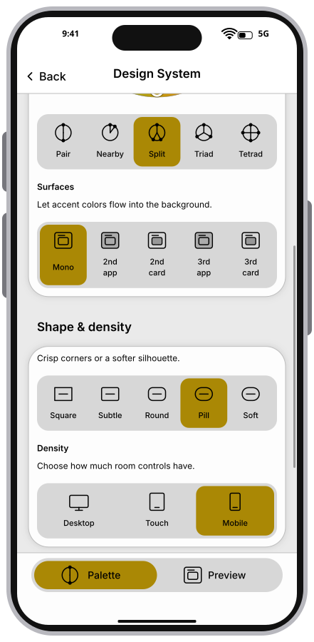
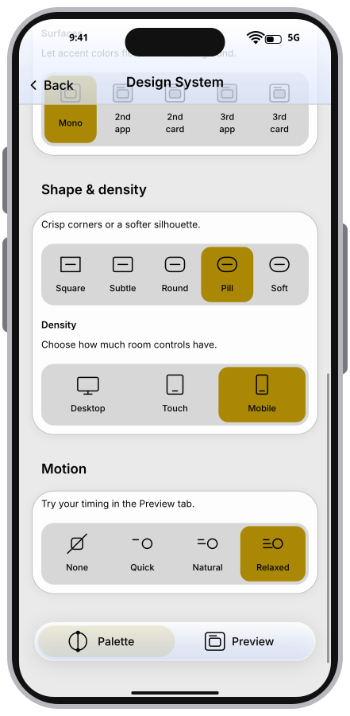
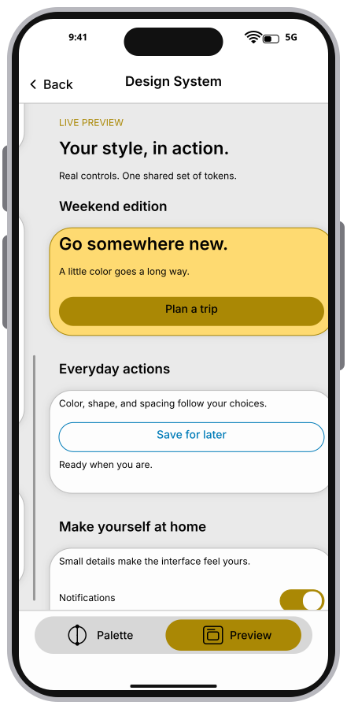
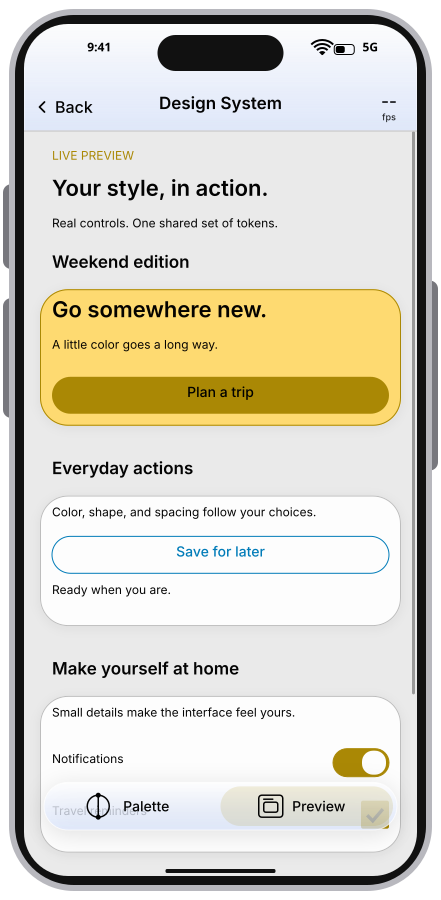
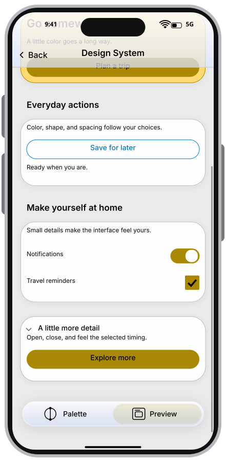

# Integration Test Run

## Timeline

# Design system — edit, preview, interact

The mobile editor uses vector choices and moving selection indicators. Scroll inertia is delivered through the page animation loop; Apple profiles also spring back at the edges. The palette and preview retain their scroll positions and share a single live design system. Images and fonts are embedded in the SVG so these snapshots remain self-contained.

### 01. Palette

Dragging the wheel updates the theme immediately, without replacing the design-system provider.

### 02. ChangedColor

### 03. ShapeAndDensity

### 04. MotionOptions

A sliding segment and eased page movement connect the editor to the live preview.

### 05. SwitchingToPreview

### 06. LivePreview

Cards, actions, toggles, and the expandable section use the updated tokens. Descriptions wrap inside their cards, and controls have a separate aligned column.

### 07. ControlsAndMotion

