# Integration Test Run

## Timeline

# Grid Layout scenarios

### 01. GridLayout.Home

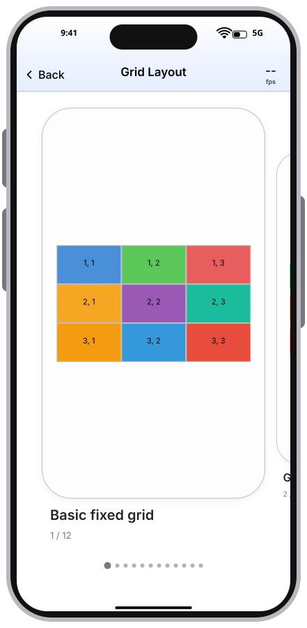

### 02. Basic.fixed.grid

### 03. Grid.with.gaps

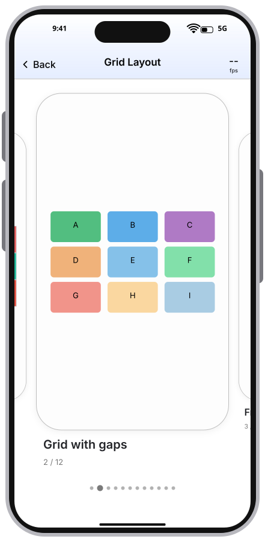

### 04. Fractional.units

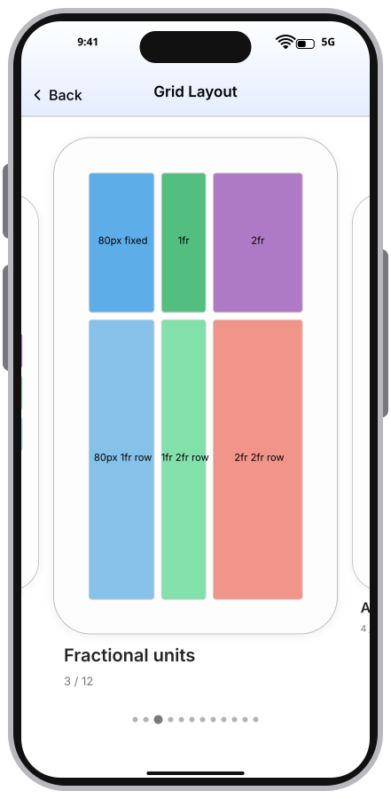

### 05. Auto.tracks

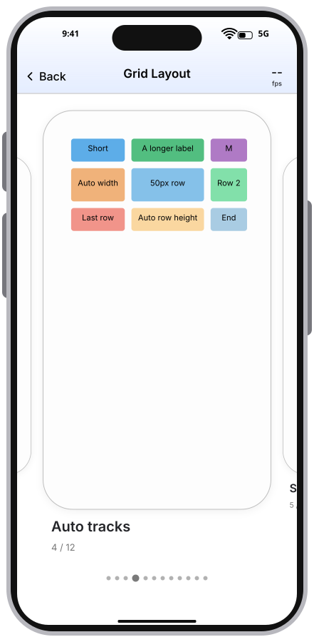

### 06. Spanning.cells

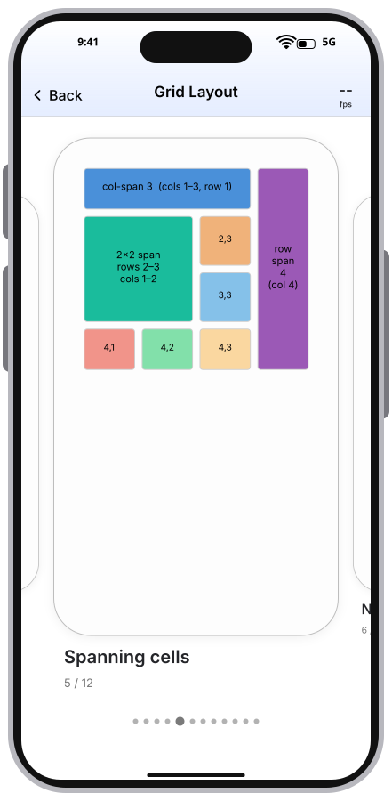

### 07. Named.areas

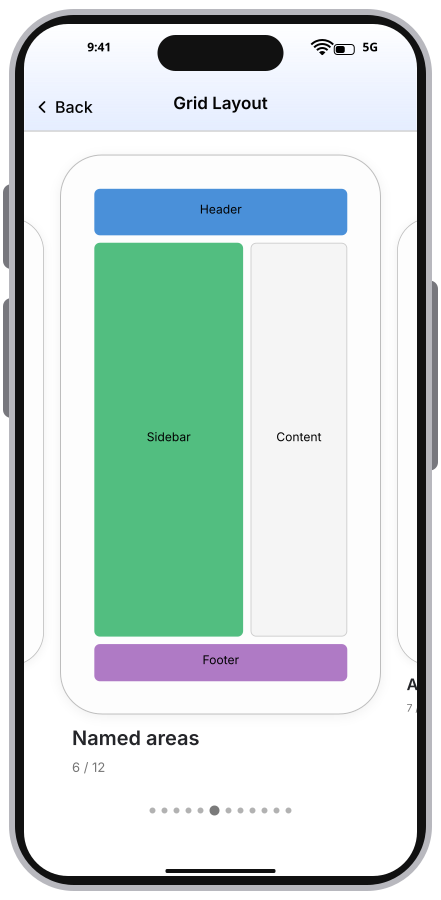

### 08. Auto.flow

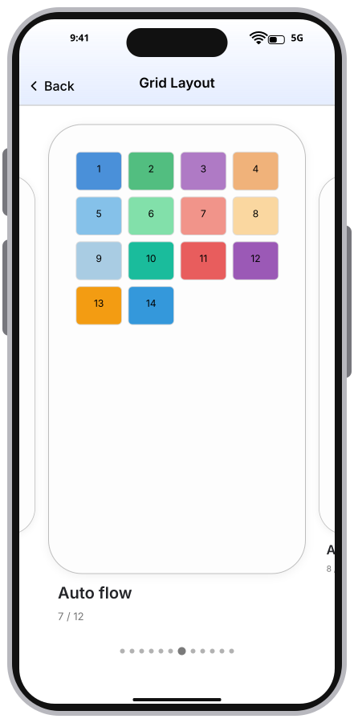

### 09. Alignment

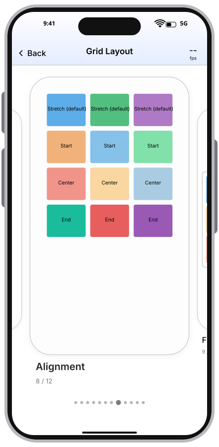

### 10. Fixed.container

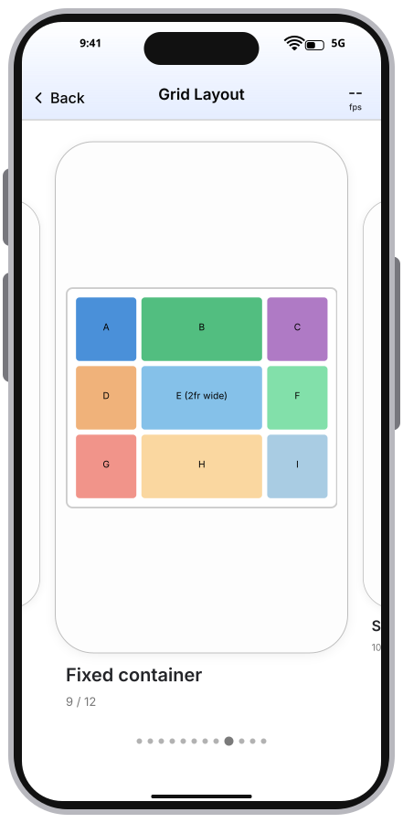

### 11. Scrollable.grid

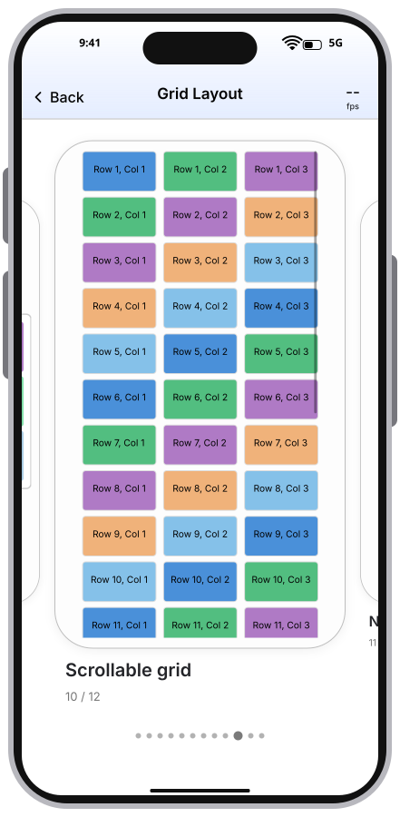

### 12. Nested.grids

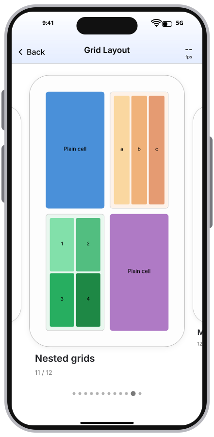

### 13. MinMax.tracks

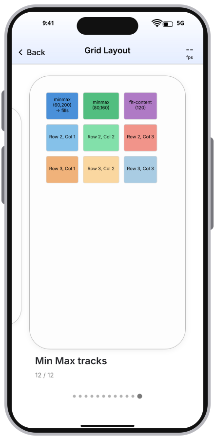

### 14. HomePage

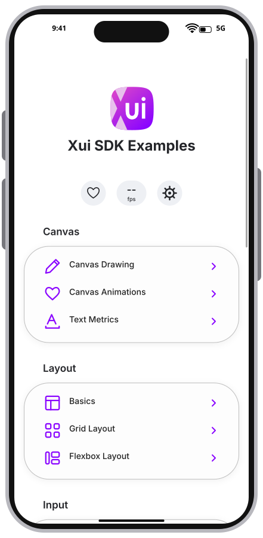
