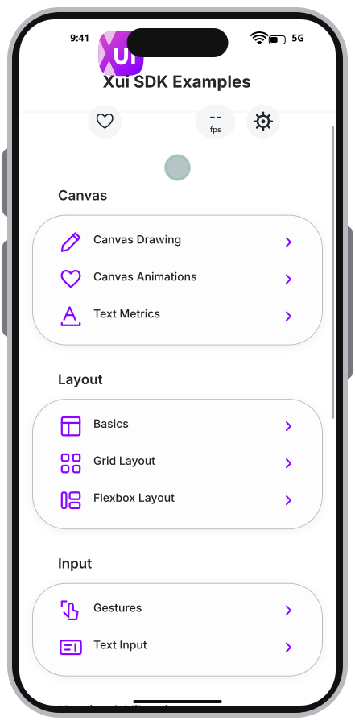
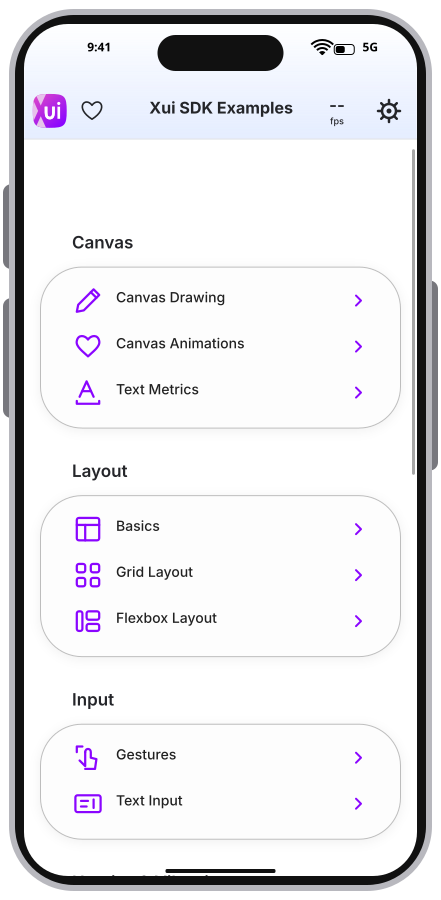
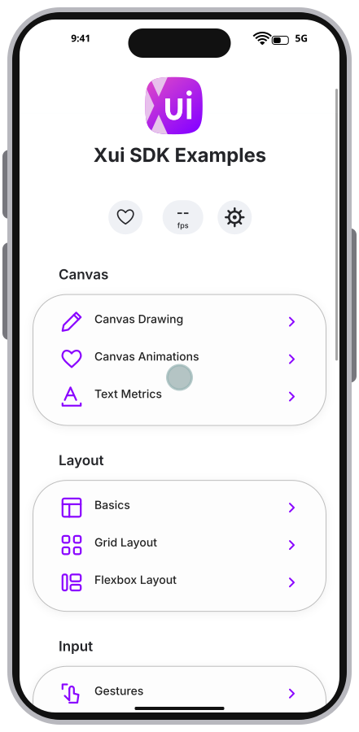
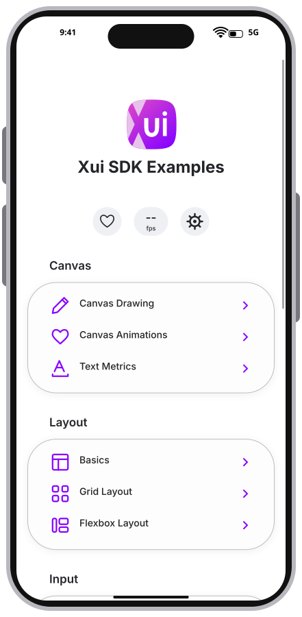

# Integration Test Run

## Timeline

# Home header

The header is an overlay inside the scroll gesture route. Pulling moves it at 60% of the content's displacement. From offset 75 to 225 it collapses into a toolbar; the 0.7-second deadline starts a 0.56-second eased finish. Returning keeps the toolbar pinned until offset 175, then expands fully by offset 25, with the same deadline and easing. Expanded elements can move above the viewport. Heart, FPS and settings remain tappable in either layout.

### 01. Expanded

### 02. Pulled

### 03. PartlyCollapsed

### 04. Toolbar

### 05. Rating

### 06. PartlyExpanded

### 07. Returned

