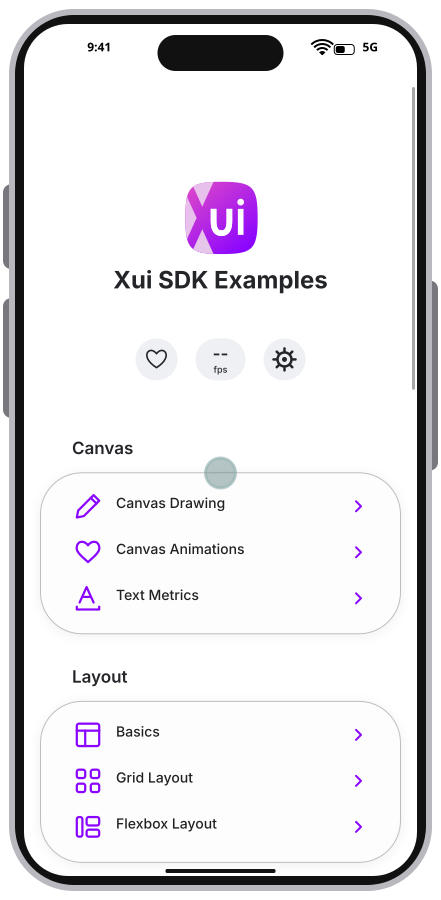
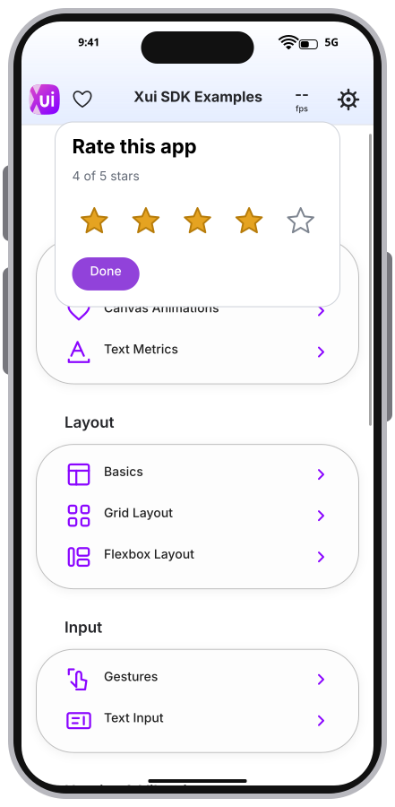
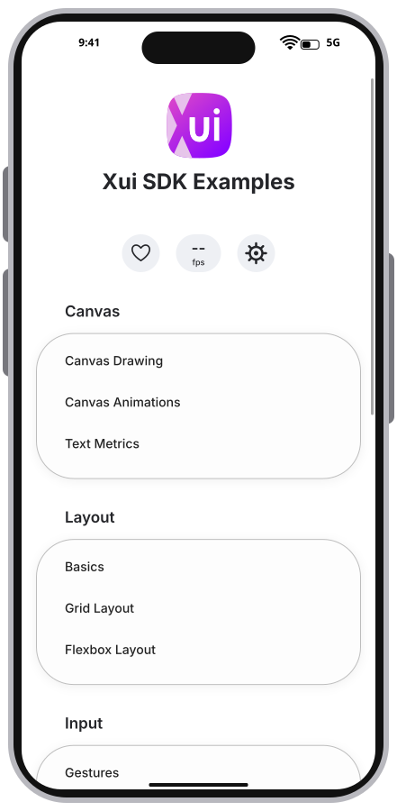

# Integration Test Run

## Timeline

# Home header

The header is an overlay inside the scroll gesture route. Pulling moves it at 60% of the content's displacement. After the first 20 points, it collapses into a toolbar; a partial collapse finishes with easing after 0.7 seconds. Heart, FPS and settings remain tappable in either layout.

### 01. Expanded

### 02. Pulled

### 03. PartlyCollapsed

### 04. Toolbar

### 05. Rating

### 06. Returned

