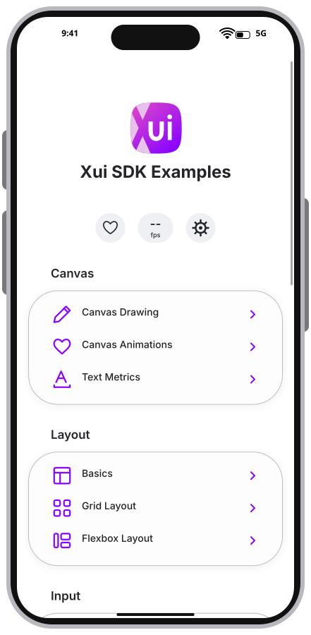
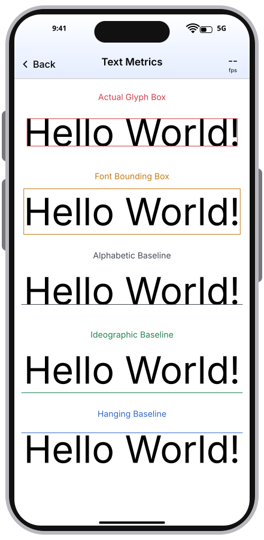
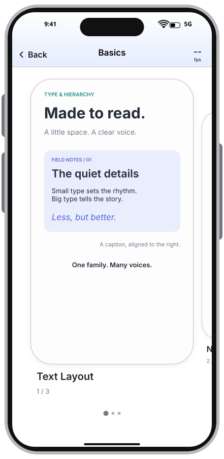
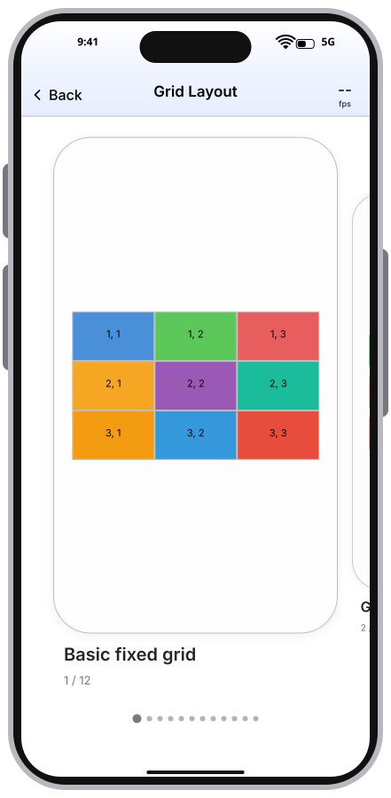
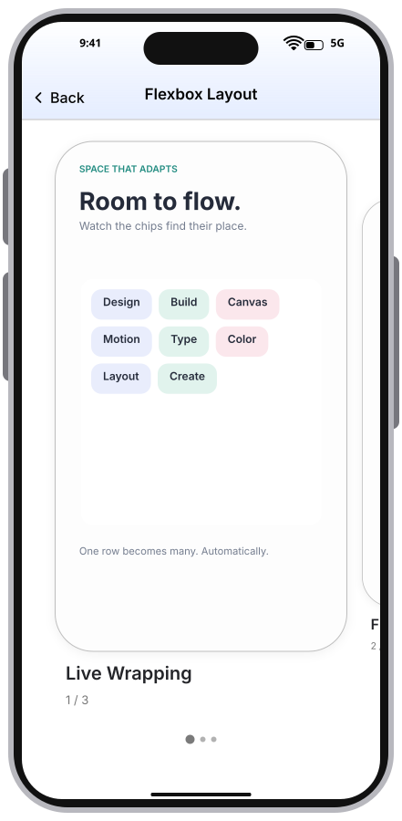
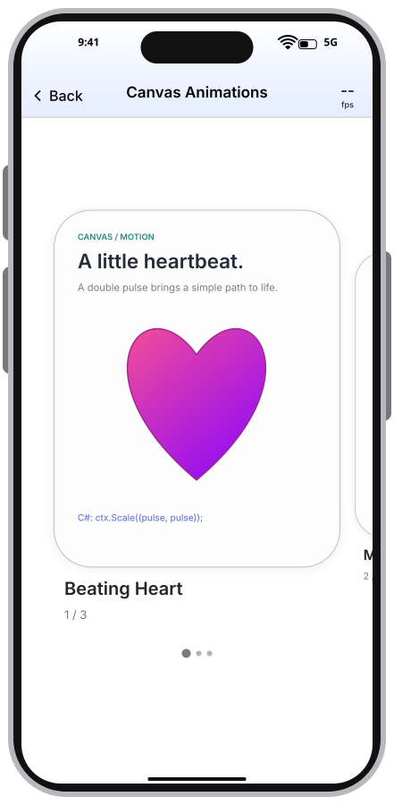
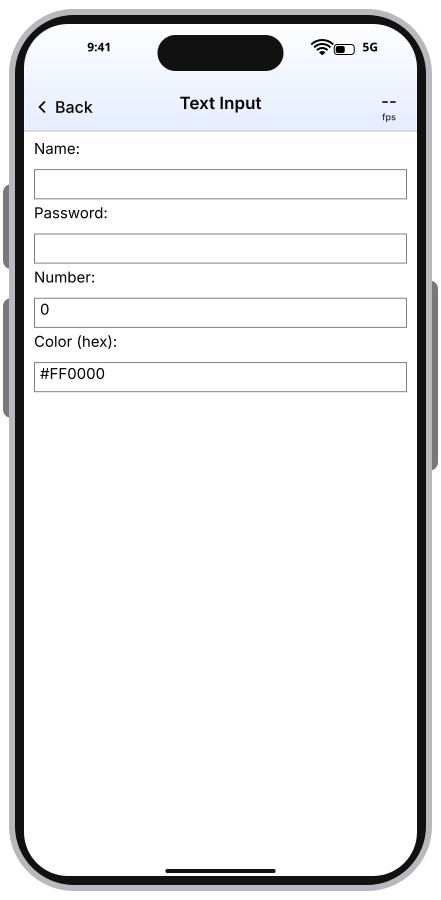

# Integration Test Run

## Timeline

# Navigate_Through_All

### 01. HomePage

### 02. TextMetrics

### 03. Basics

### 04. GridLayout

### 05. FlexboxLayout

### 06. AnimatedHeart

### 07. TextBox

