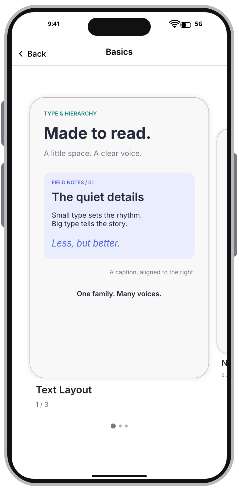
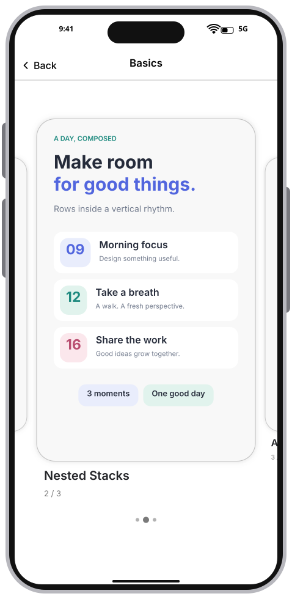
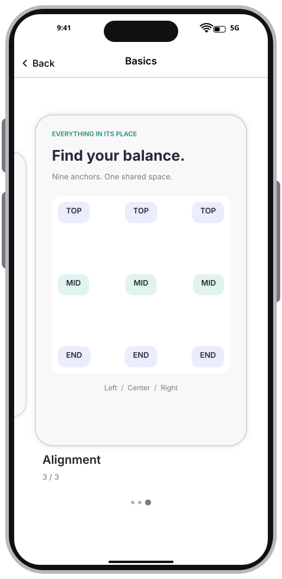
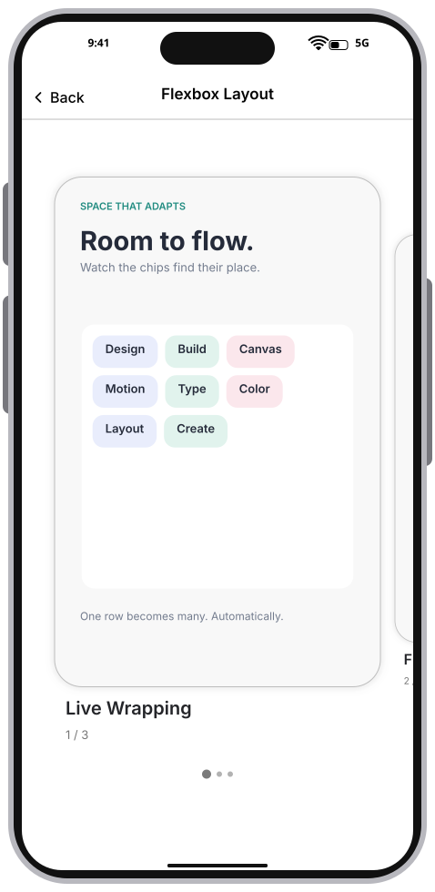
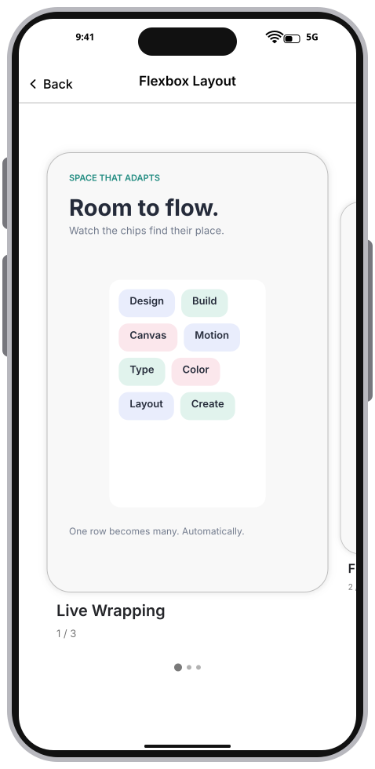
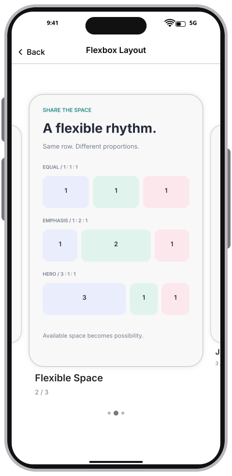
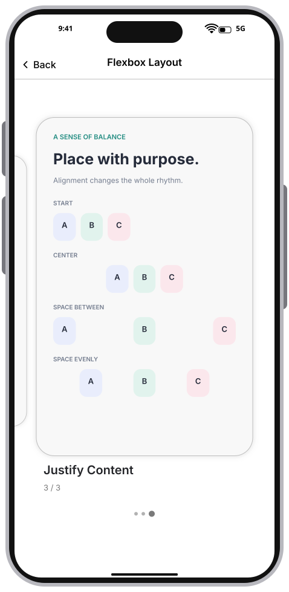

# Integration Test Run

## Timeline

# Layout galleries

Basics explores text hierarchy, nested stacks, and nine-point alignment. Flexbox demonstrates live wrapping as its container narrows, proportional growth, and main-axis justification. Each gallery uses retained, snapping cards.

### 01. TextLayout

### 02. NestedStacks

### 03. Alignment

### 04. WrappingWide

### 05. WrappingNarrow

### 06. FlexibleSpace

### 07. JustifyContent

