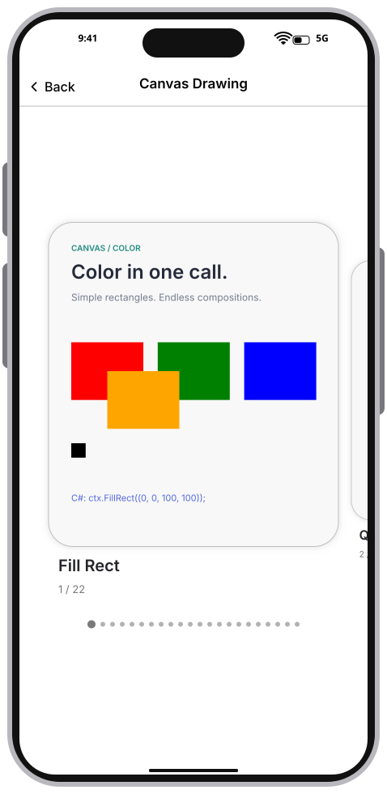
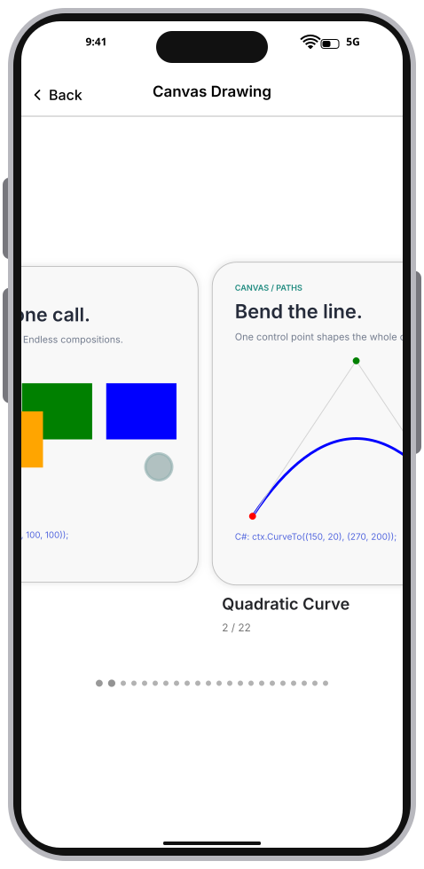
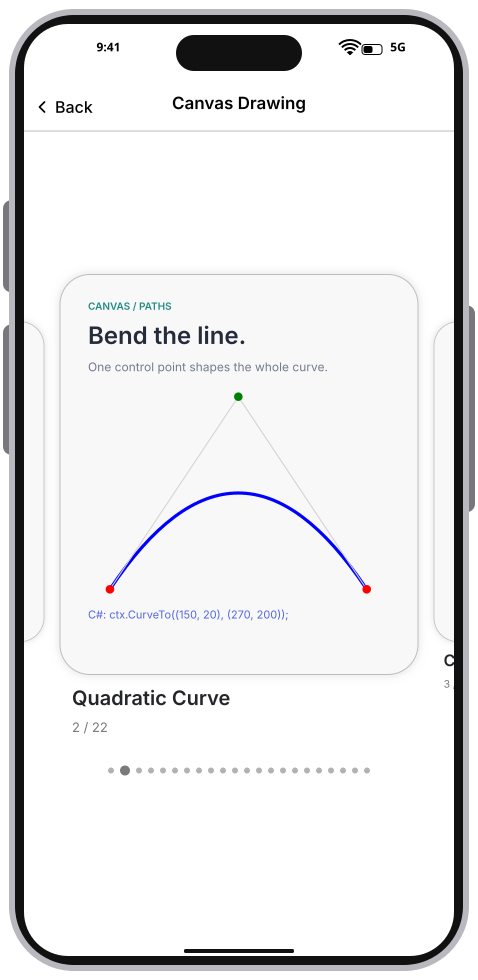
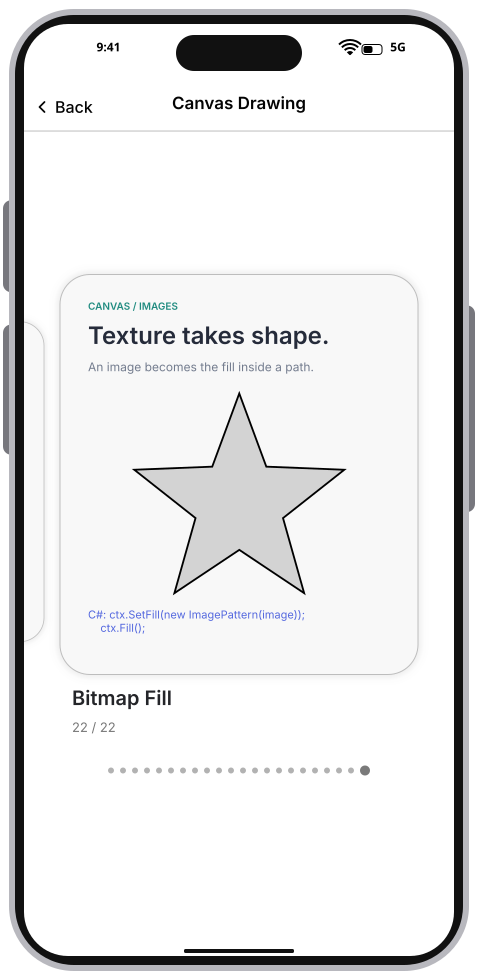
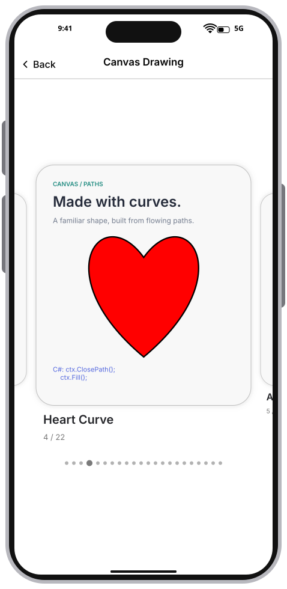
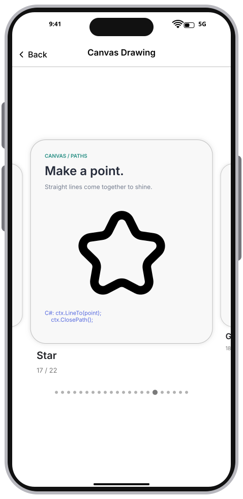
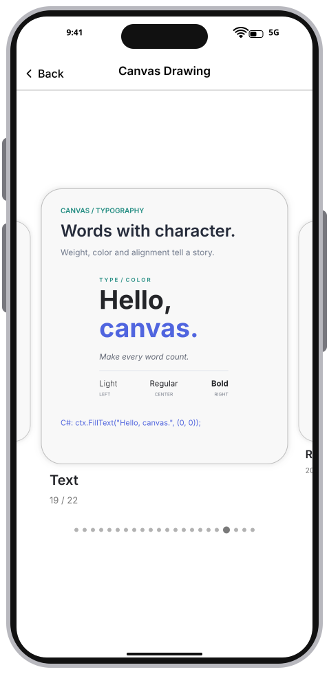
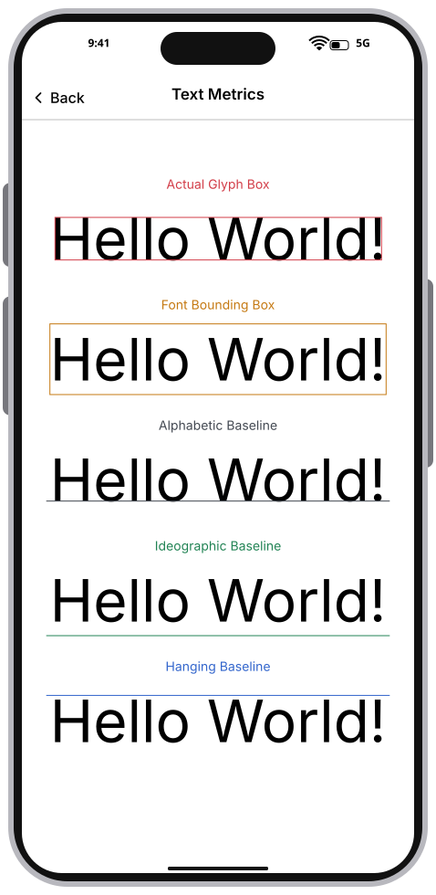

# Integration Test Run

## Timeline

# Canvas Drawing cards

Swipe horizontally between retained drawing cards. Release settles one card in the center; the left screen edge remains available for back navigation.

### 01. FirstCard

### 02. Dragging

### 03. SecondCard

### 04. LastCard

### 05. HeartCurve

### 06. Star

### 07. Text

## Standalone Text Metrics

Five separate samples show the actual glyph box, font bounding box, and alphabetic, ideographic, and hanging baselines. Each sample has one guide and a small heading.

### 08. TextMetricsPage

