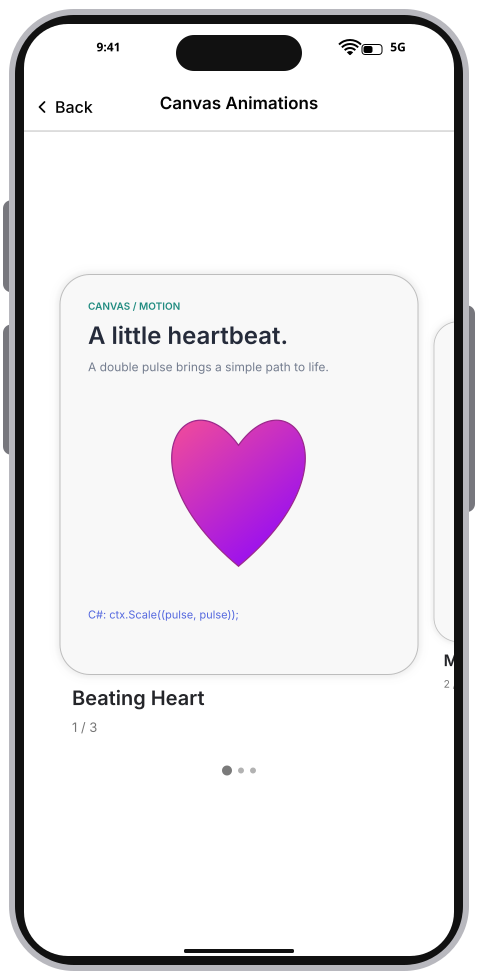
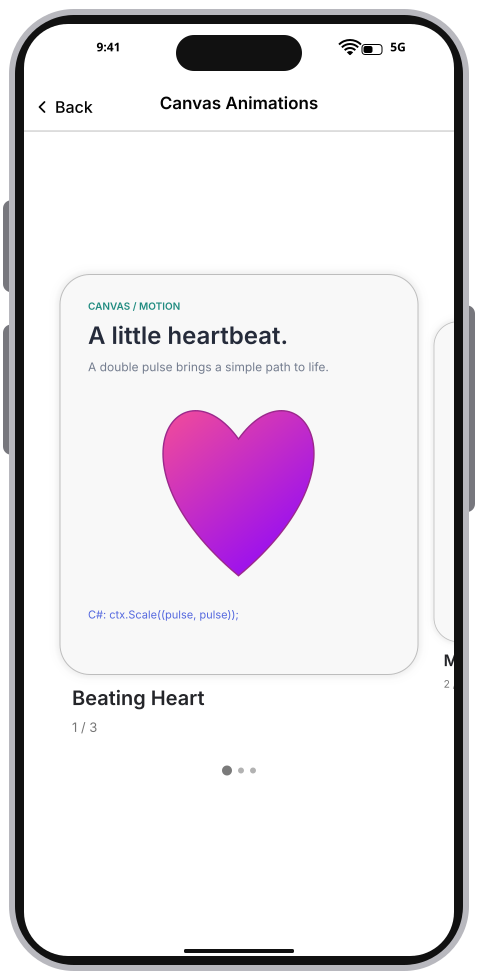
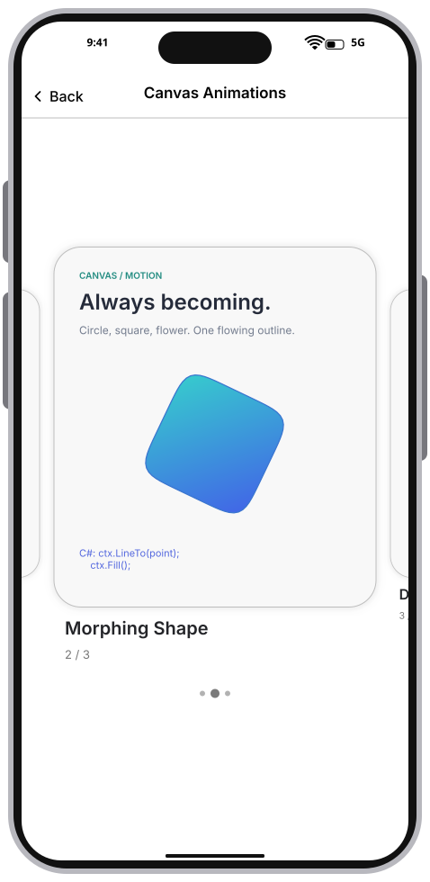
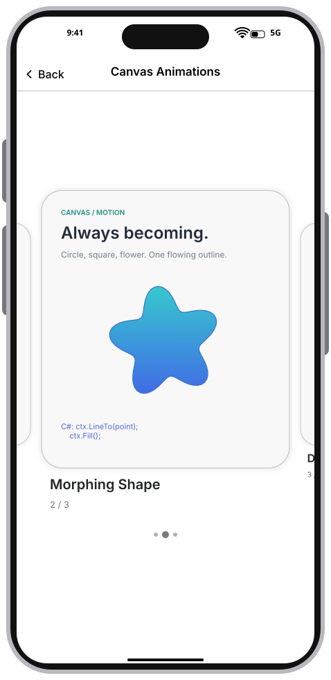
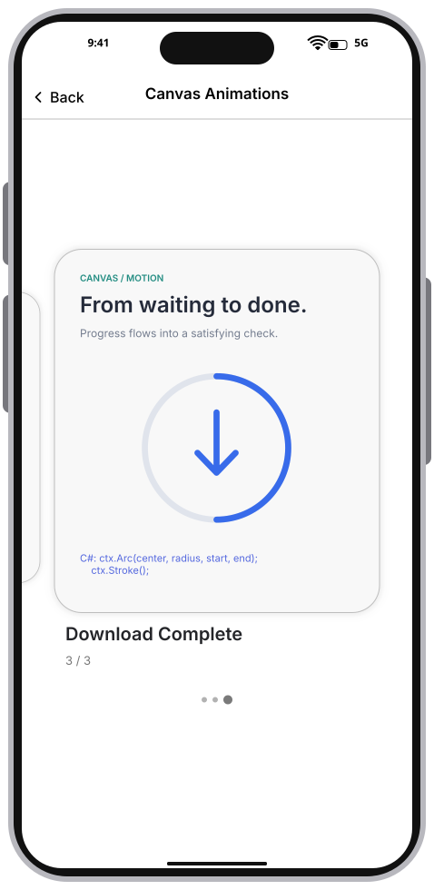
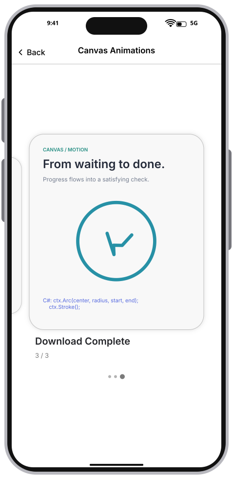
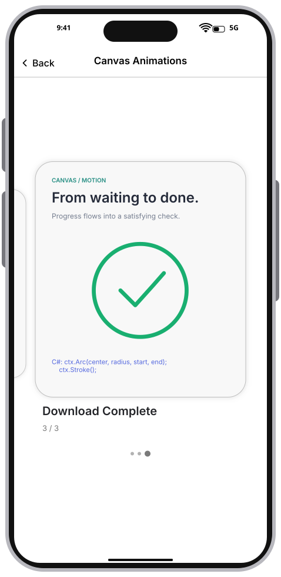

# Integration Test Run

## Timeline

# Canvas Animations

Three vector animations driven by frame time: a double-pulse heart, a rotating circle/square/flower morph, and a download arrow becoming a completion check. Cards retain their geometry and snap to the center after a swipe.

### 01. HeartRest

### 02. HeartBeat

### 03. RoundedSquare

### 04. Flower

### 05. Downloading

### 06. ArrowToCheck

### 07. Complete

