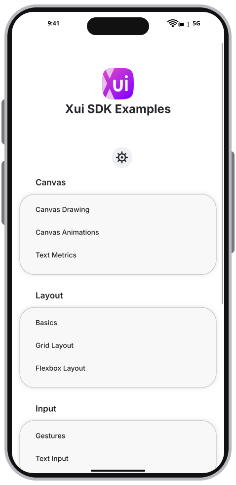
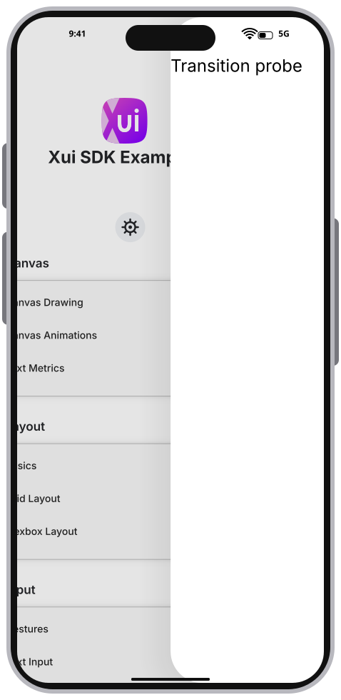
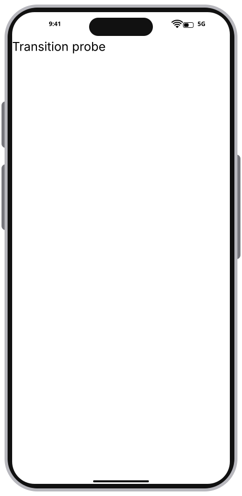
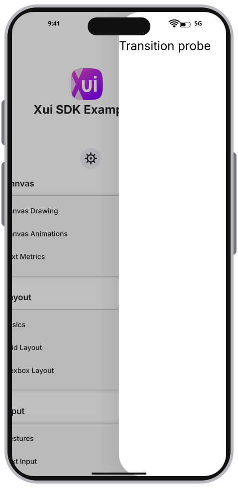

# Integration Test Run

## Timeline

# TestApp home-screen rendering reference

Mobile TestApp on a 430×932 logical-point iPhone reference surface, including emulator frame, safe areas, and deterministic status bar (478×980 SVG). Initial home screen, before navigation or pointer input.

Rendered by the deterministic software SVG context with embedded Inter font subsets. The SVG records fills, strokes, text, transforms, and clipping for a future standalone drawing experiment; it is a visual reference, not a recording of native CGContext calls or an iOS timing measurement.

### 01. HomePage

## Moving top page

Push and pop a simple probe page. Only the moving top page gets a rounded clip; one stationary background covers the display and back-page content is clipped to the exposed region. Settled navigation draws only its active page. Opaque navigation keeps host clearing disabled throughout. The probe uses linear easing so the midpoint snapshots show the top page halfway across the display.

### 02. PushHalfway

### 03. Pushed

### 04. PopHalfway

### 05. Returned

