# Integration Test Run

## Timeline

# Grid Layout cards

Twelve grid examples in tall cards. Horizontal swipes snap one card into place with eased page dots; the scrollable grid also supports vertical dragging inside its card.

### 01. BasicFixedGrid

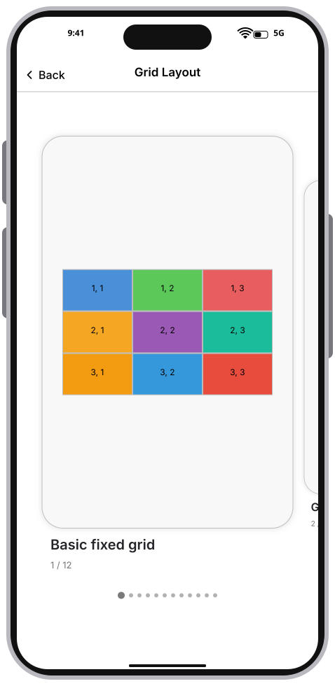

### 02. Dragging

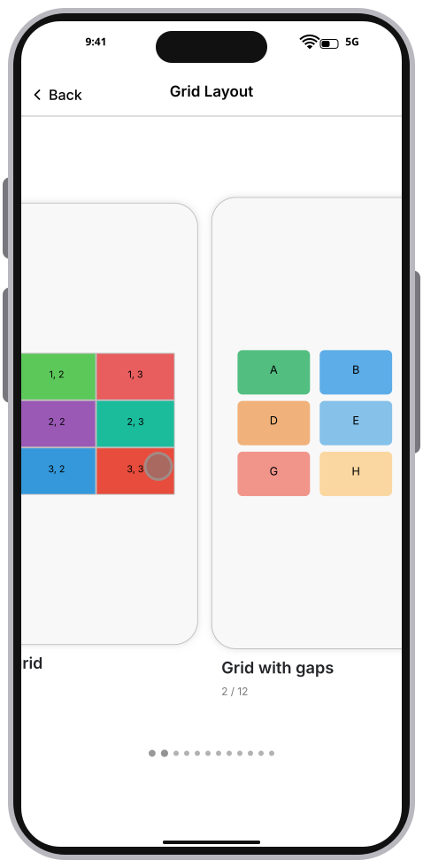

### 03. Gridwithgaps

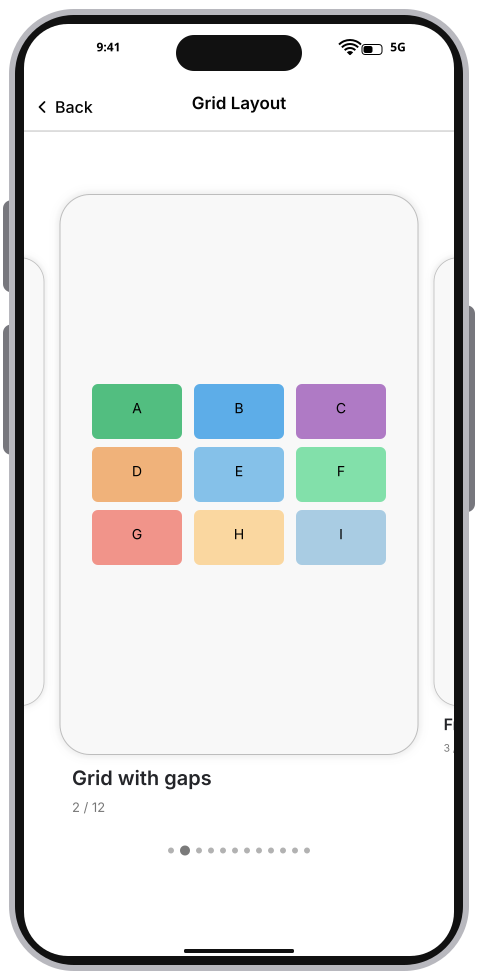

### 04. Fractionalunits

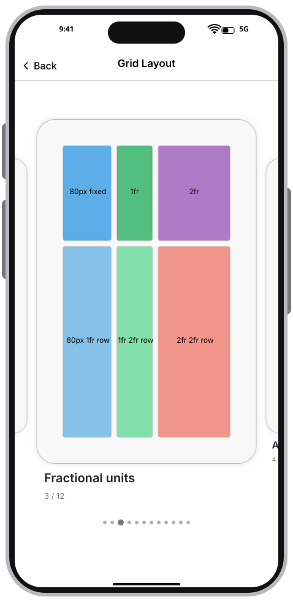

### 05. Autotracks

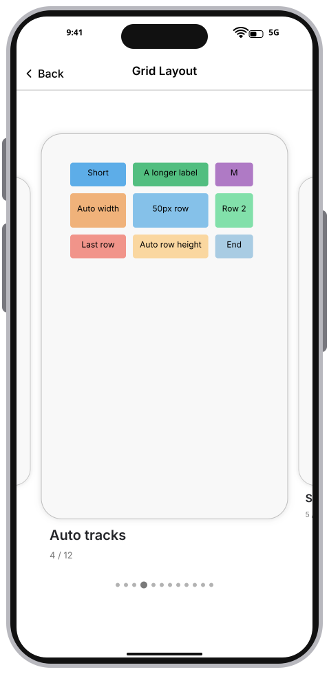

### 06. Spanningcells

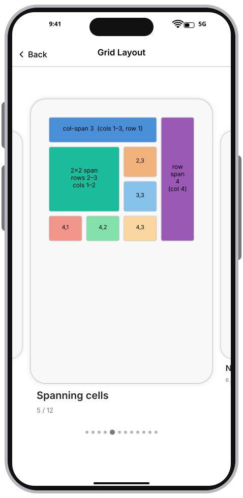

### 07. Namedareas

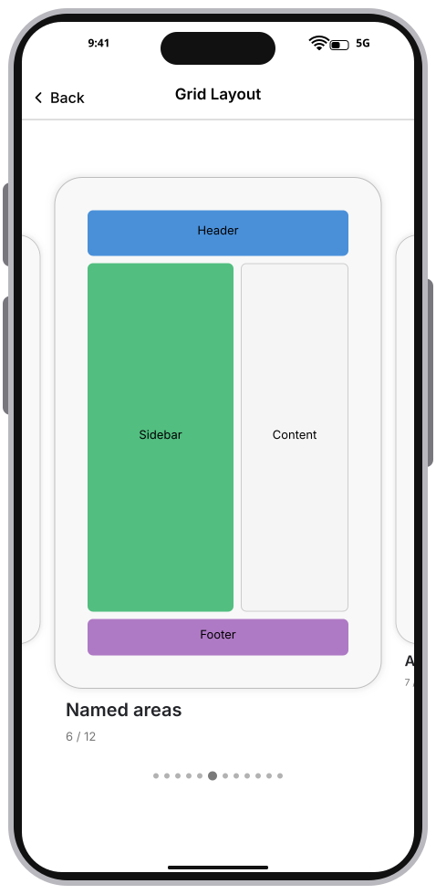

### 08. Autoflow

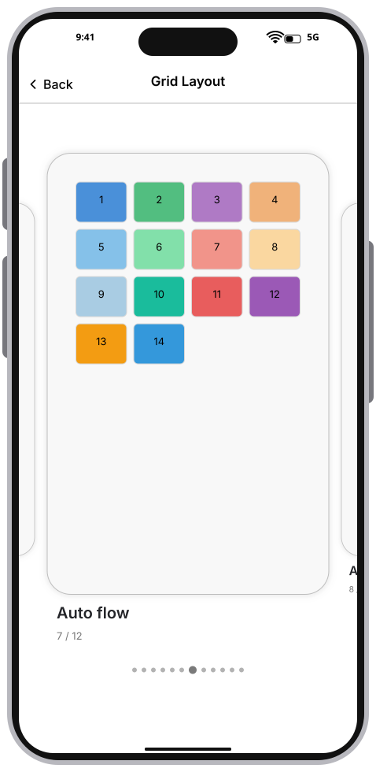

### 09. Alignment

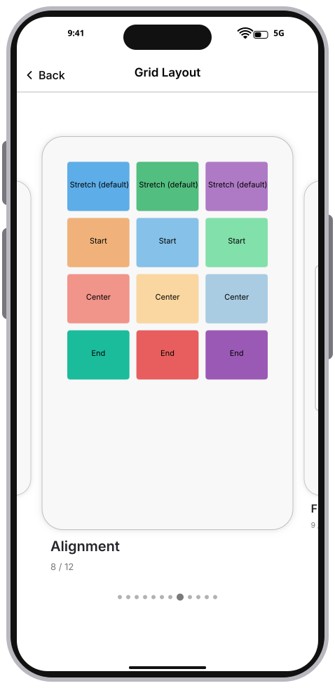

### 10. Fixedcontainer

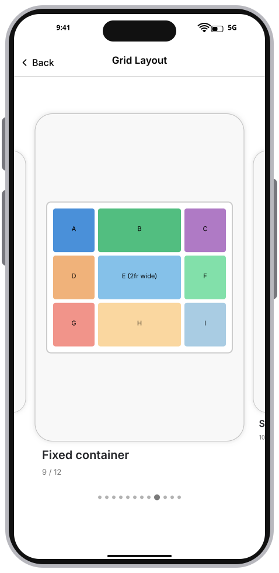

### 11. Scrollablegrid

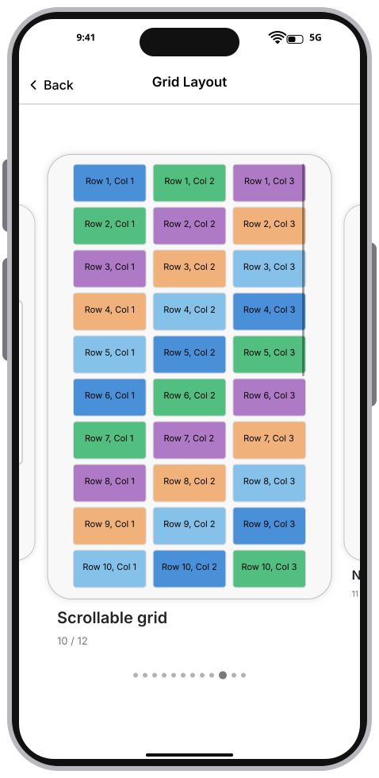

### 12. Nestedgrids

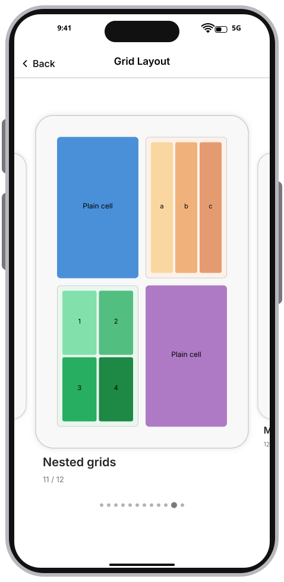

### 13. MinMaxtracks

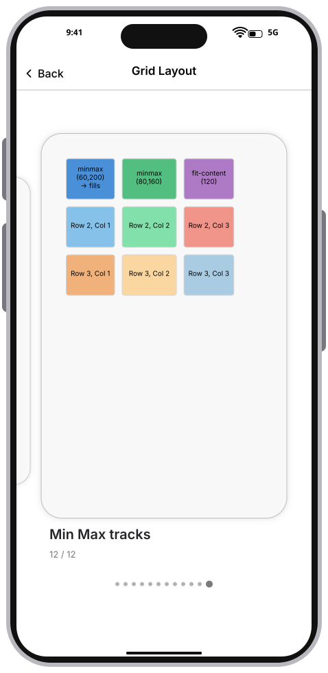

### 14. ScrolledGrid

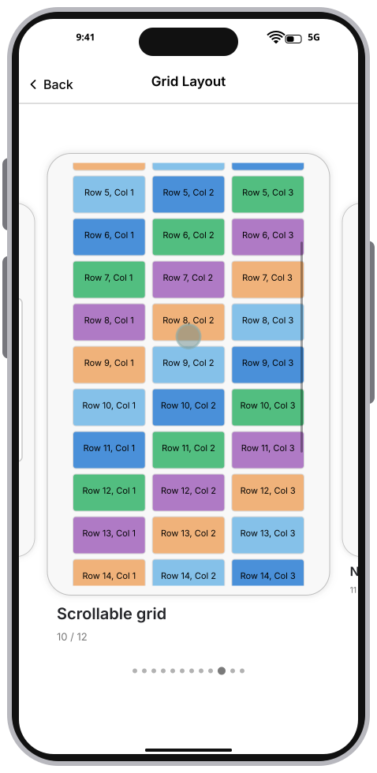
