# Integration Test Run

## Timeline

# Input: touch, intent, and motion

Six tall cards demonstrate independent touch bubbles, nested horizontal and vertical scrolling, tap-versus-drag negotiation, a snapping temperature ruler, a vector floor plan with two-finger zoom, and reversible swipe actions. Swipe the title and description below each demo, or tap a page dot to change cards. Scrollable content reaches the card edges while its text and controls retain their inset.

### 01. GestureVisualizer

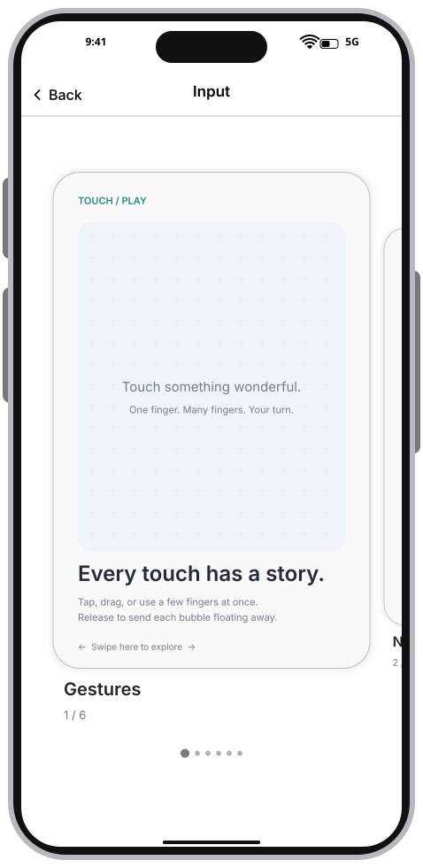

### 02. TwoTouches

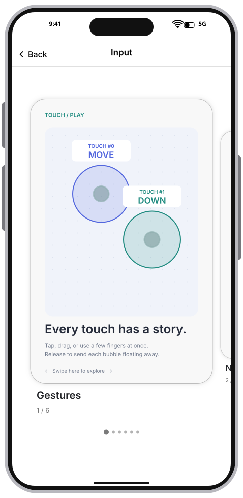

### 03. ReleasedBubbles

### 04. NestedScrolls

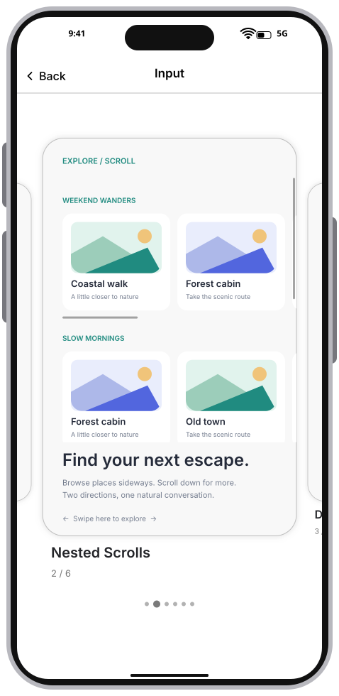

### 05. NestedVerticalScroll

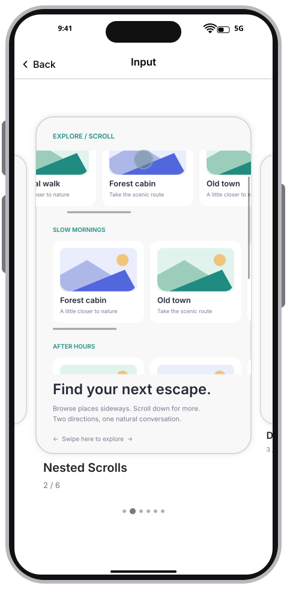

### 06. DragVsTap

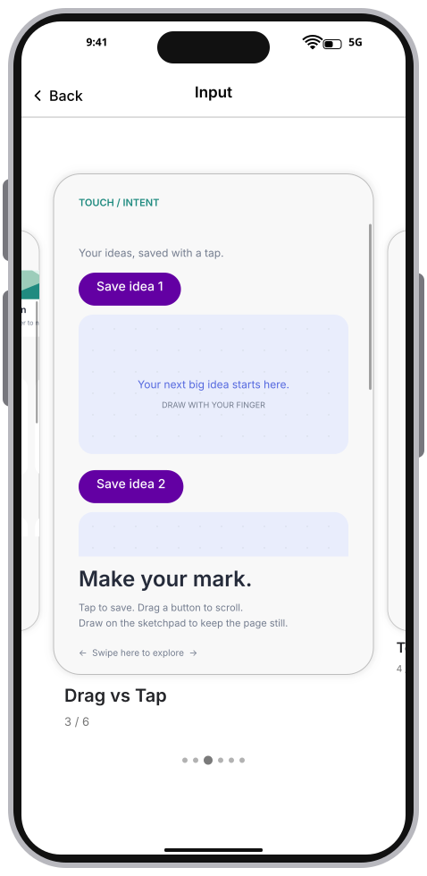

### 07. SketchSaved

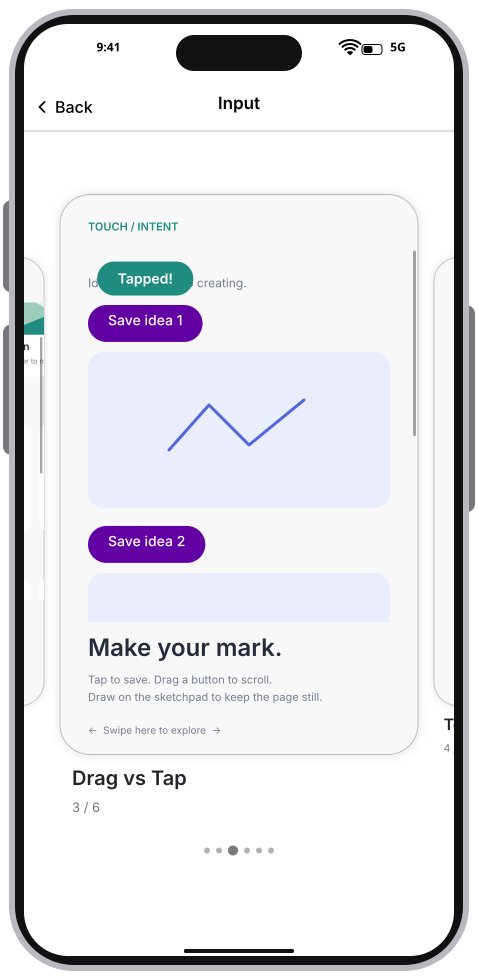

### 08. Temperature

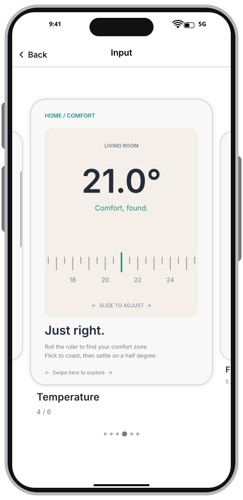

### 09. TemperatureAdjusted

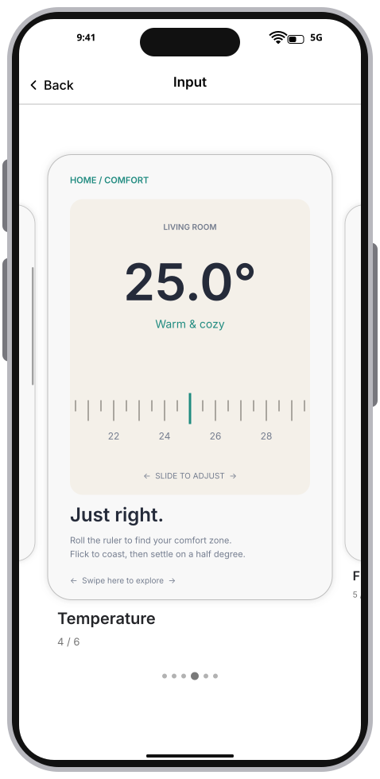

### 10. FloorPlan

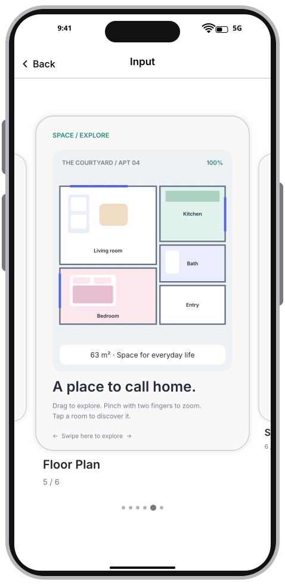

### 11. PinchZoom

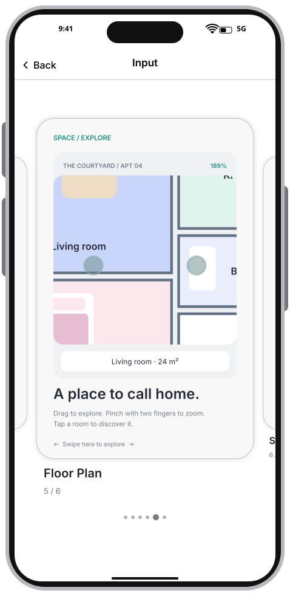

### 12. OneFingerContinuesPan

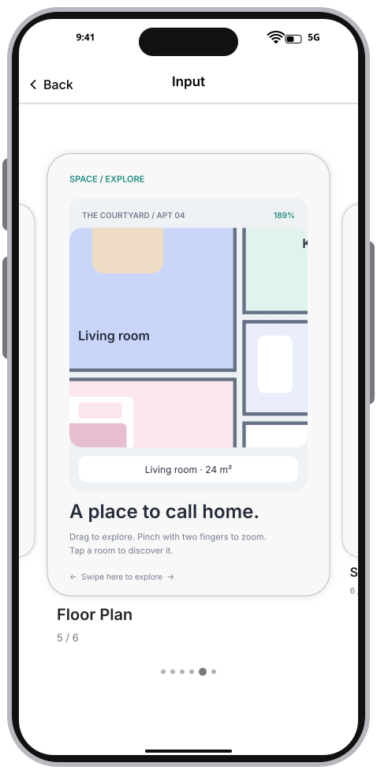

### 13. Inbox

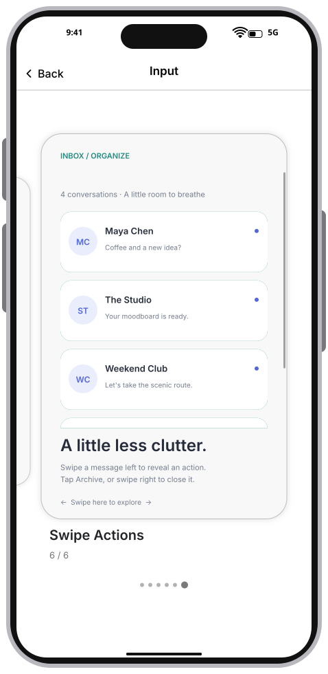

### 14. ArchiveRevealed

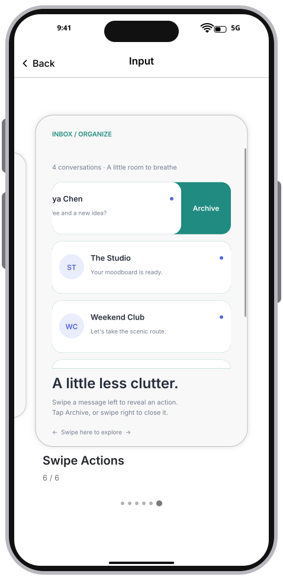

### 15. Archived

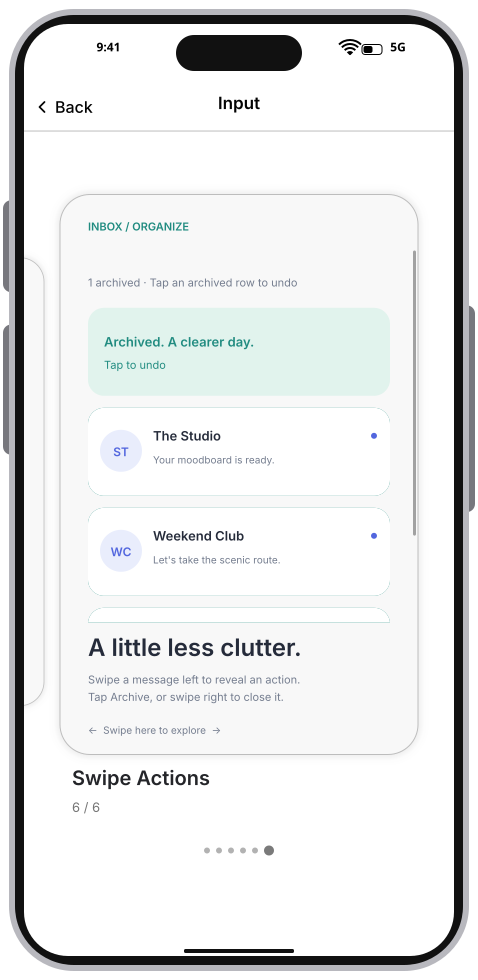
