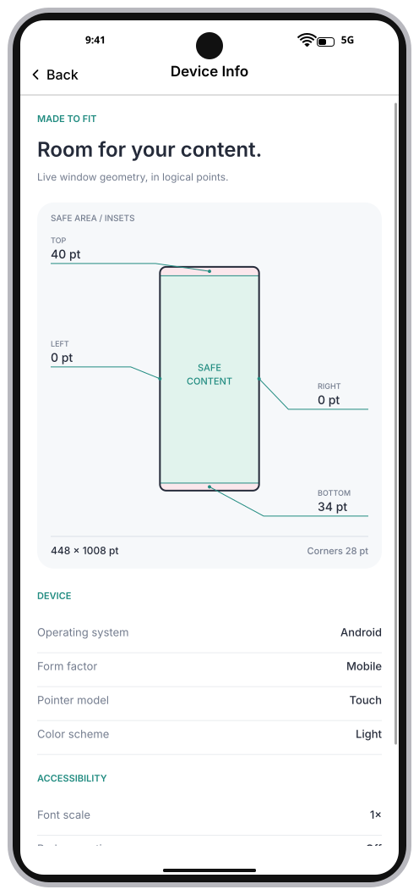
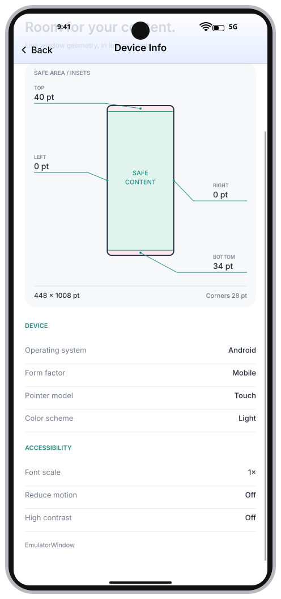

# Integration Test Run

## Timeline

# Device Info — Android

The real TestApp Device Info page runs inside the phone emulator. The emulator supplies the mobile OS, touch input model, preferences, window geometry, and device frame. Inter fonts are embedded in each SVG so the layout is readable without locally installed fonts.

- Display: 448 × 1008 logical points; screen corner radius: 28 pt.
- Safe-area insets: top 40 pt, right 0 pt, bottom 34 pt, left 0 pt.
- Safe content: 448 × 934 pt, starting at (0, 40).
- Mocked device: Android, Mobile, Touch, Light; font scale 1×; reduce motion and high contrast off.

## Window geometry

A proportional window outline surrounds the tinted safe-content region. Underlined top, right, bottom, and left measurements connect to the center of each safe-area inset band. Zero-width insets place their dots on the screen edge. Display dimensions and corner radius appear below the diagram.

### 01. SafeArea

## Device and accessibility

Scroll down to reveal device values, a separate ACCESSIBILITY section for font scale, reduce motion, and high contrast, and the emulator runtime. Labels stay on the left, values align on the right, and the final row remains inside the safe area.

### 02. DevicePreferences

