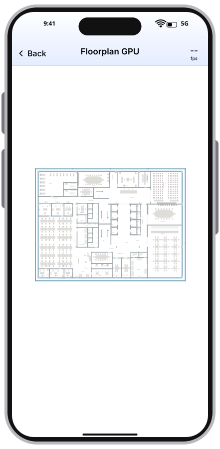
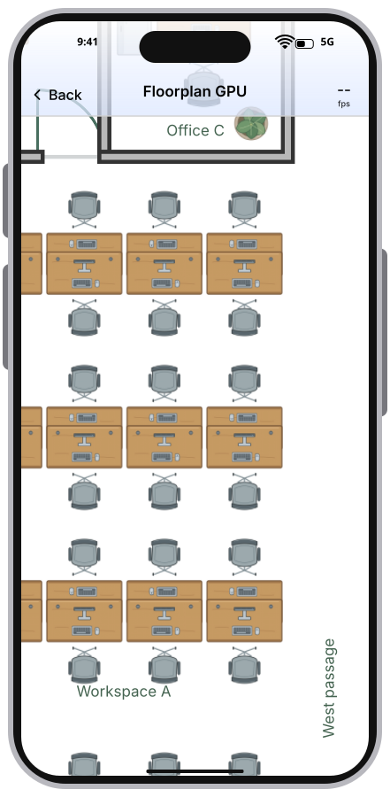

# Integration Test Run

## Timeline

# Floorplan GPU

Generated furniture atlas and wall/door quad meshes, with vector text. The test executes the same C# shader in software.

### 01. Overview

### 02. Detail

