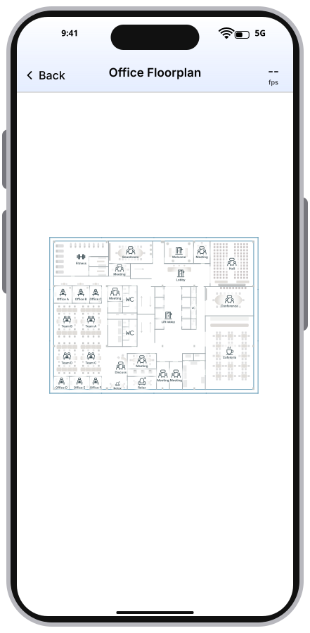
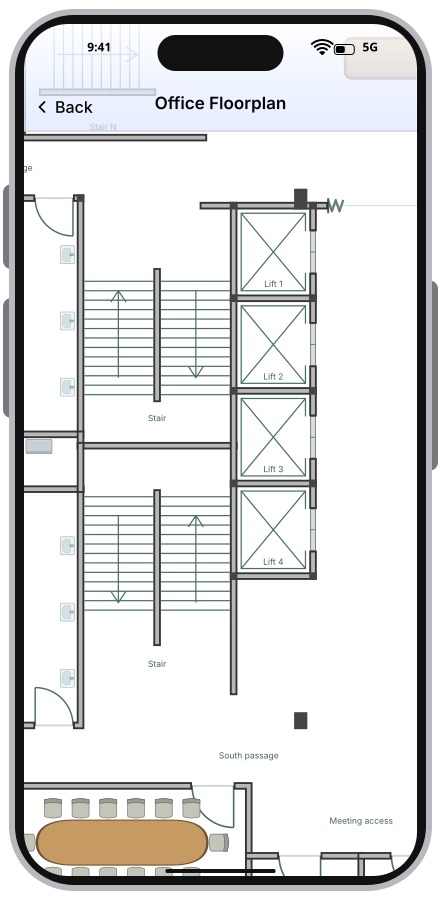

# Integration Test Run

## Timeline

# Office floorplan: one vector map view

Drag to pan; pinch or use the mouse wheel to zoom around the pointer. The embedded SVG is resolved once into shared paths and four detail levels. On phones, overview markers fade at 320%; furniture changes at 250%, 440%, and 800%, up to 1000%. Offscreen rooms are culled. The map creates no composition children or bitmap snapshots. Allocation coverage measures warmed managed drawing/recording, not native rasterization.

The map extends beneath the header and status bar. iOS uses the native backdrop blur without an app-supplied background color; SVG approximates that native material.

### 01. Overview

### 02. Interior

### 03. Detail

