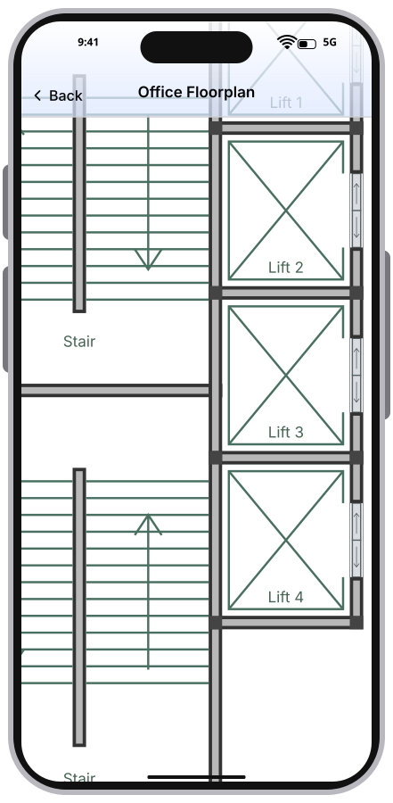

# Integration Test Run

## Timeline

# Office floorplan: one vector map view

Drag to pan; pinch or use the mouse wheel to zoom around the pointer. The embedded SVG has build-time CSS resolution and explicit presentation attributes; it loads into shared paths, reusable furniture symbols, and four detail levels. On phones, overview markers fade at 320%; furniture changes at 250%, 440%, and 800%, up to 1000%. Levels 0 and 1 each retain one whole-floorplan surface; levels 2 and 3 retain and cull individual rooms. Stable composition keys reuse native surfaces without adding Xui child views. Allocation coverage measures warmed managed drawing/recording, not native rasterization.

The map extends beneath the header and status bar. iOS uses the native backdrop blur without an app-supplied background color; SVG approximates that native material. The header FPS badge uses the shared rounded frame-rate sample and opens the detailed overlay when tapped.

### 01. Overview

### 02. Interior

### 03. Detail

