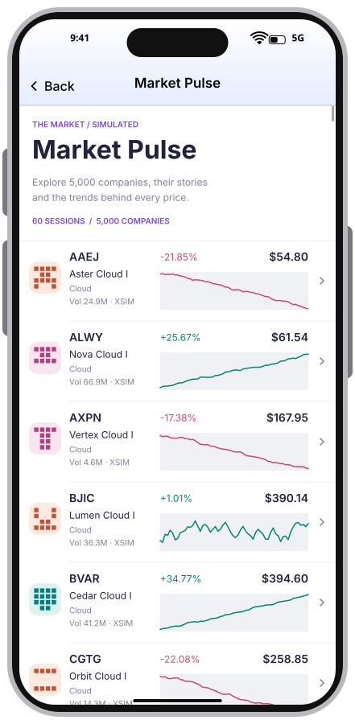
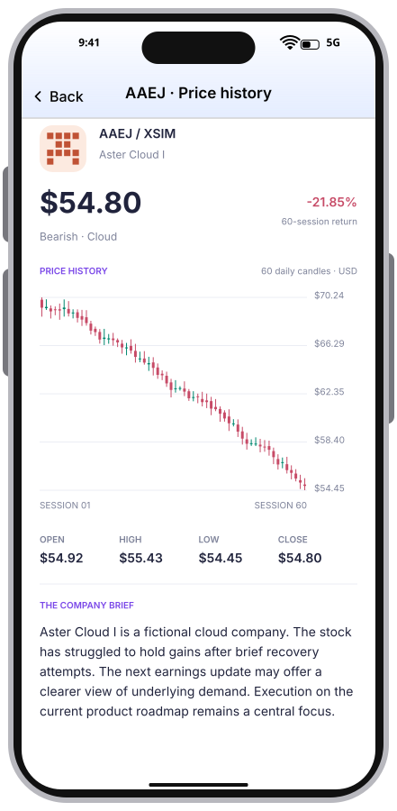
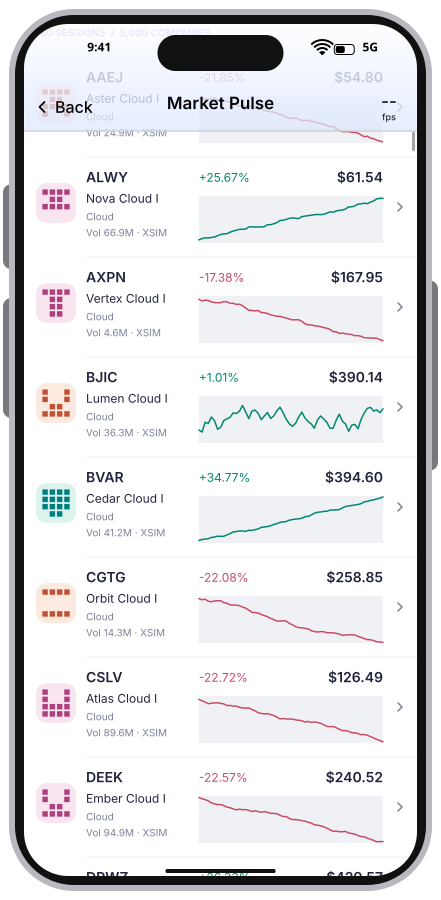

# Integration Test Run

## Timeline

# Market Pulse: a layer-composed 5,000-row grid

Fixed-seed fictional companies, compiled vector logos, 60-session sparklines and OHLC candles. One grid view composes struct layers for visible rows. No row views or recycler. Rows load on first visibility; full details load when opened. Allocation tests measure the managed canvas recording path for cached rows; native rasterization is outside that measurement.

### 01. MarketList

### 02. CompanyDetails

### 03. RowsUnderHeader

