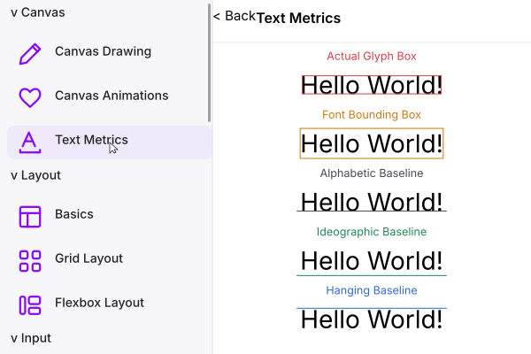
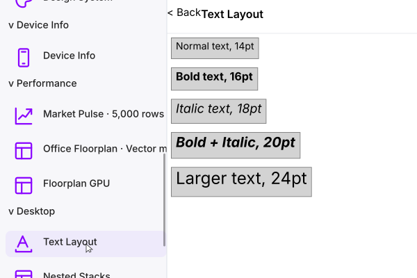
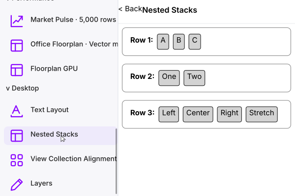
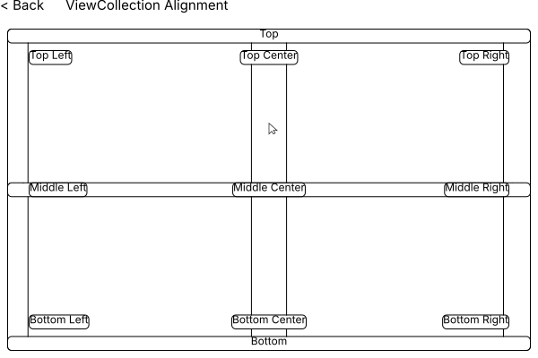
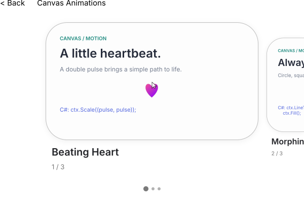
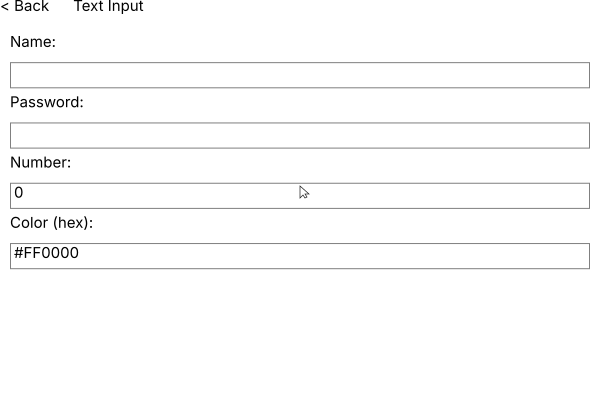

# Integration Test Run

## Timeline

# Navigate_Through_All

### 01. HomePage

### 02. TextMetrics

### 03. TextLayout

### 04. NestedStacks

### 05. ViewCollectionAlignment

### 06. AnimatedHeart

### 07. TextBox

